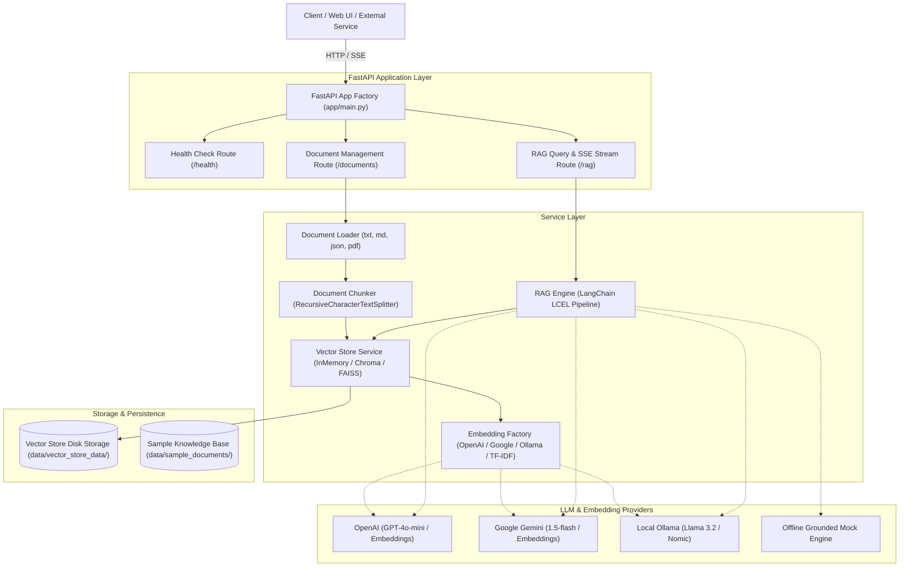
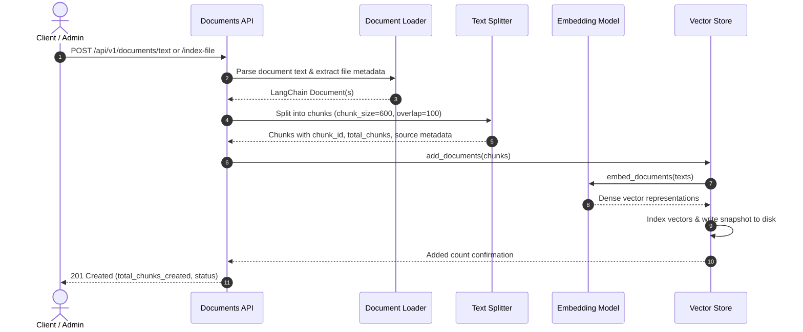
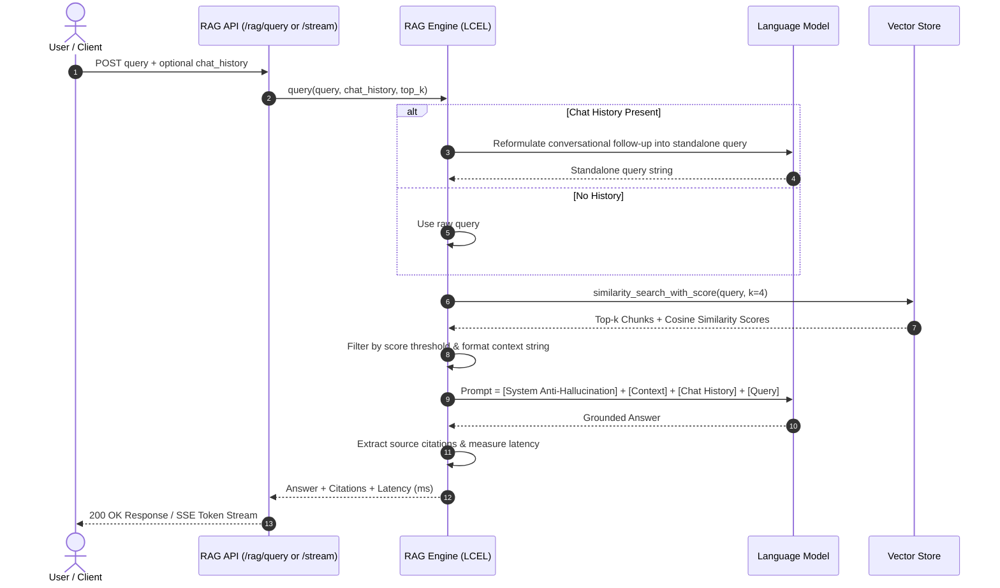

# Architecture & Design Specifications

## 1. System Overview

The **Enterprise RAG System** is designed following clean layered architecture principles, decoupling HTTP handling, business orchestration, vector retrieval, and model inference.

---

## 2. Document Ingestion Pipeline

---

## 3. Conversational RAG Query Flow

---

## 4. Key Architectural Choices

| Architectural Component | Decision | Rationale |
| :--- | :--- | :--- |
| **Orchestration** | Modern LangChain LCEL (`\|`) | Eliminates legacy deprecated `RetrievalQA` chains; provides native streaming (`.stream()`), composability, and clean typing. |
| **API Framework** | FastAPI + Pydantic v2 | High async throughput, automatic OpenAPI documentation, schema validation, and dependency injection. |
| **Vector Database** | Modular Adapter (`InMemoryVectorStore`, `ChromaDB`, `FAISS`) | Provides instant zero-install out-of-the-box local operation while supporting drop-in switching to Chroma or FAISS for enterprise scale. |
| **Multi-Turn Handling** | Query Reformulation Chain | Resolves core conversational ambiguity (e.g. *"What are its disadvantages?"*) without polluting vector search with unrelated dialogue turns. |
| **Anti-Hallucination** | System Constraint + Fallback | Strictly prohibits speculative responses when retrieved context similarity falls below threshold or lacks necessary information. |
